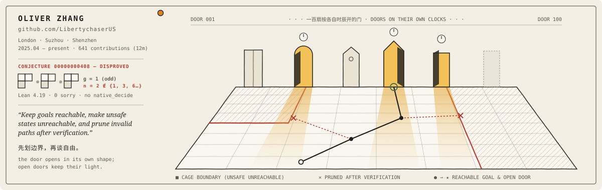
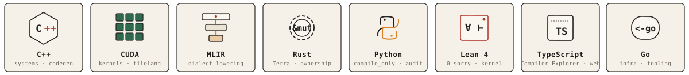
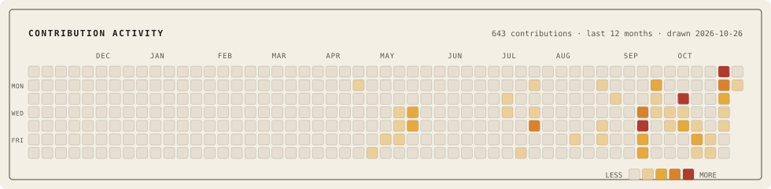

  <picture>
    <source media="(prefers-color-scheme: dark)" srcset="./assets/banner-v2-dark.svg" />
    <source media="(prefers-color-scheme: light)" srcset="./assets/banner-v2.svg" />
    
  </picture>

**Oliver Zhang** · London / Suzhou / Shenzhen · Off duty, chess.

> Keep goals reachable, make unsafe states unreachable, and prune invalid paths after verification.  
> 裁决先于相信，阈值先于数据。

  <picture>
    <source media="(prefers-color-scheme: dark)" srcset="./assets/tech-stack-dark.svg" />
    <source media="(prefers-color-scheme: light)" srcset="./assets/tech-stack.svg" />
    
  </picture>

### Upstream (`merged`)

| Project | PR | Verdict & Scope |
| :--- | :--- | :--- |
|  [`tile-ai/tilelang`](https://github.com/tile-ai/tilelang) |  [`#3045`](https://github.com/tile-ai/tilelang/pull/3045) | Official compile-only CLI: `python -m tilelang.tools.compile_only` lowers kernels to source without executing them. |
|  [`compiler-explorer/compiler-explorer`](https://github.com/compiler-explorer/compiler-explorer) |  [`#9029`](https://github.com/compiler-explorer/compiler-explorer/pull/9029) | Integrated TileLang as a compile-only language in Compiler Explorer. |
|  [`compiler-explorer/compiler-explorer`](https://github.com/compiler-explorer/compiler-explorer) |  [`#9210`](https://github.com/compiler-explorer/compiler-explorer/pull/9210) | Single regex parsing binary asm source lines in `objdump` output across Linux, Windows, and `llvm-objdump`. |
|  [`compiler-explorer/infra`](https://github.com/compiler-explorer/infra) |  [`#2307`](https://github.com/compiler-explorer/infra/pull/2307) [`#2381`](https://github.com/compiler-explorer/infra/pull/2381) | TileLang `0.1.13` and `0.1.14` pip packages. |
|  [`The-Last-Math-Competition`](https://github.com/The-Last-Math-Competition) |  [`#920`](https://github.com/The-Last-Math-Competition/The-Last-Math-Competition/pull/920) | Disproved Conjecture `00000000408`: for `n = 2`, Kronecker coefficient `g((2,1),(2,1),(2,1)) = 1` is odd while `2` is not triangular. Lean 4.19 proof (`0 sorry`, no `native_decide`, no extra axioms). |

### Public Repositories

<table>
  <tbody>
    <tr>
      <td width="76" align="center" valign="top"></td>
      <td width="190" valign="top"><a href="https://github.com/LibertychaserUS/caging-engineering"><strong>caging-engineering</strong></a></td>
      <td valign="top">An agent is not a mind to instruct but a space to shape. The cage is not a wall around it; it is the geometry of what can happen next. Goals stay reachable, unsafe states become unreachable, and paths that failed are pruned after the fact rather than forbidden in advance. <em>Freedom is what remains once the boundary is drawn.</em></td>
    </tr>
    <tr>
      <td width="76" align="center" valign="top"></td>
      <td width="190" valign="top"><a href="https://github.com/LibertychaserUS/Terra"><strong>Terra</strong></a></td>
      <td valign="top">Caging taken literally, as a runtime. Nothing the model wants happens until it has passed through something that cannot be persuaded. Memory has owners and levels, because knowledge anyone may overwrite is not knowledge. Every action leaves a trace that outlives the conversation. <em>Efficiency is intelligence.</em></td>
    </tr>
    <tr>
      <td width="76" align="center" valign="top"></td>
      <td width="190" valign="top"><a href="https://github.com/LibertychaserUS/AIOps"><strong>AIOps</strong></a></td>
      <td valign="top">The gate belongs to the repository, not to whoever is pushing. Forge decides who may touch a protected branch; Overlay turns requirements into tests that can be read before they are run. Machines may propose, review and fail loudly. Only a person merges. <em>Fail closed. Never self-merge.</em></td>
    </tr>
    <tr>
      <td width="76" align="center" valign="top"></td>
      <td width="190" valign="top"><a href="https://github.com/LibertychaserUS/OfficeX-an-AI-agents-for-doc"><strong>OfficeX</strong></a></td>
      <td valign="top">The intelligent part finishes thinking; this is the part that makes the document true. It does not try to be clever. It executes exactly, then looks at the result three ways: as structure, as a page, as meaning. Errors invisible in text are made visible before anyone reads. <em>Correctness is not an opinion the model holds.</em></td>
    </tr>
    <tr>
      <td width="76" align="center" valign="top"></td>
      <td width="190" valign="top"><a href="https://github.com/LibertychaserUS/microfluidic-native-physics"><strong>microfluidic-native-physics</strong></a></td>
      <td valign="top">Hold out an entire chemistry, seal the labels, and let the model fail in public. The negative result stays in the record, because a record that remembers only success is not a record. Every claim arrives with a table of what it is not allowed to mean. <em>Thresholds before data. Negative results stay.</em></td>
    </tr>
    <tr>
      <td width="76" align="center" valign="top"></td>
      <td width="190" valign="top"><a href="https://github.com/LibertychaserUS/world-cellular-automata"><strong>world-cellular-automata</strong></a></td>
      <td valign="top">The world as a state that rewrites itself. Each node opens into a local world, evolves by pairwise interaction, and collapses back into the next state. The baseline is protected, the evaluation is strict, and the <a href="https://doi.org/10.5281/zenodo.21085154">report</a> is archived where it cannot be quietly revised. <em>A prediction is a claim about the next state, nothing more.</em></td>
    </tr>
    <tr>
      <td width="76" align="center" valign="top"></td>
      <td width="190" valign="top"><a href="https://github.com/LibertychaserUS/bsaa-gaokao-theory"><strong>bsaa-gaokao-theory</strong></a></td>
      <td valign="top">Choosing under admission uncertainty, treated as a submodular problem. The theory lives in a repository of its own so the mathematics can be judged apart from the product. What the greedy rule guarantees is proved, and the proof is re-checked by a kernel that cannot be flattered. <em>Proved, then checked by something that does not argue.</em></td>
    </tr>
    <tr>
      <td width="76" align="center" valign="top"></td>
      <td width="190" valign="top"><a href="https://github.com/LibertychaserUS/robot-pm"><strong>robot-pm</strong></a></td>
      <td valign="top">A project assistant that does less than it could. It checks what exists before it creates anything, prints the name of what is missing and never its value, and calls no meeting without the group's consent. Time is Beijing time. <em>Consent before action. Presence before creation.</em></td>
    </tr>
    <tr>
      <td width="76" align="center" valign="top"></td>
      <td width="190" valign="top"><a href="https://github.com/LibertychaserUS/100-journeys"><strong>100-journeys</strong></a></td>
      <td valign="top">A hundred doors, each opening on its own hour. The one project here that is about how a thing feels, made with the same care as the ones about whether it holds. <em>the door opens in its own shape; open doors keep their light.</em></td>
    </tr>
  </tbody>
</table>

### Contribution activity

  <picture>
    <source media="(prefers-color-scheme: dark)" srcset="./assets/contributions-dark.svg" />
    <source media="(prefers-color-scheme: light)" srcset="./assets/contributions.svg" />
    
  </picture>

